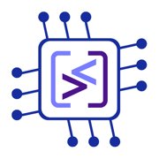

<div align="center">



# RCS Task Hackathon: Starter kit

Build the place where RUET Computing Society runs its weekly Sessions.

</div>

1. Read **[BRIEF.md](BRIEF.md)**: what to build, how it is judged, and how to submit.
2. Click **Use this template** and create your own **private** repository from it. Don't fork.
3. Follow **[CONTRIBUTING.md](CONTRIBUTING.md)** to run it locally.
4. Ask questions in **[the Discussion](https://github.com/ruetcs/task-hackathon-kit/discussions/1)**. Answers that change the Brief land in the kit repo's **[FAQ.md](https://github.com/ruetcs/task-hackathon-kit/blob/main/FAQ.md)**.

The kit has the club site's stack (Next.js 15, React 19, Tailwind CSS 4, Supabase), its theme, its site chrome and its dashboard pieces, a fixed database core, and seed data. Everything else is yours to build.

## Your Entry

A home for Session Tasks on ruetcs.org: Learners submit work at `/learn`, an AI gives it a first read against the Mentor's criteria within seconds, Mentors and Officers run their Sessions at `/mentor`, and a leaderboard at `/learn/leaderboard/` shows how everyone is doing.

- Demo video (3 minutes or less): _not recorded yet_
- Decisions: [DECISIONS.md](DECISIONS.md)

### Run it

Follow [CONTRIBUTING.md](CONTRIBUTING.md), "Set up locally". The two variables in `.env.example` are enough on a local stack. These are optional:

| Variable | What it is for |
|---|---|
| `SUPABASE_SERVICE_ROLE_KEY` | Lets the server write the AI's score, which no signed-in person may do. On a local `supabase start` stack it is worked out for you; **a deployment must set it** (`npx supabase status -o env` prints it locally). DECISIONS.md, "The service-role key". |
| `GEMINI_MODEL` | Overrides the Gemini model used when `EVALUATOR=gemini`. |
| `CRON_SECRET` | Vercel sends it to the daily sweep at `/api/evaluations/sweep/`; without it the sweep does nothing. |

```bash
npm run gate      # lint, tsc, 81 unit tests, build, kit-check
npm run test:db   # 105 pgTAP checks of the access rules, as each seed person
```

`npm run test:db` needs the seeded local database (`npx supabase db reset`).

### Where things are

| | |
|---|---|
| `supabase/migrations/2026111[2-5]*` | Columns, policies, the hand-in trigger, the override functions, Storage policies, the Session timeline, the leaderboard and Track status. |
| `supabase/tests/` | The same rules, tried as each seed person with only their own session. |
| `supabase/data/` | The society's own plan of Sessions, to load by hand into a local database. Not part of the seed. |
| `lib/evaluate.ts`, `lib/tasks/evaluator-*.ts` | The evaluator seam: `mock`, `gemini`, `fail`. |
| `lib/tasks/` | Every decision, as a pure module with a test: deadlines, criteria, redaction, retries, forms, what each side is shown. |
| `lib/tasks/run-evaluation.ts` | One run of the evaluator for one Submission, and what a failure means. |
| `content/tasks.ts` | Every string. |
| `app/(site)/learn/`, `app/mentor/` | The two areas. |
| `components/tasks/`, `styles/tasks.css` | The pieces the kit did not have. |

## Licence

The fonts in `public/fonts/` keep their own licences (see the files beside them). Everything else is © RUET Computing Society and is provided only for building an Entry to this Hackathon.
